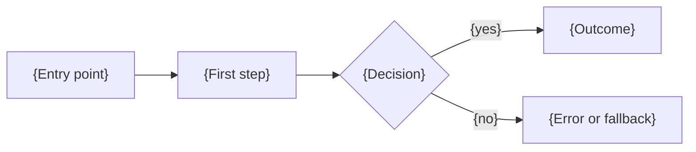

# PRD: {feature or product name}

Status: {draft, in review, or approved}, {YYYY-MM-DD}. Target release: {version}.
Roadmap entry: {milestone ID}. Design: {link to the design specification}.

This page says what {feature} is for, who it serves, and how we will know it worked. The design
specification says how it is built, and this page does not repeat it.

> **Good:** a reader who has never seen the project can say, after reading section 1, what ships
> and who benefits. Every requirement can be tested, and every success metric names how it is
> measured.

## 1. Summary

{Two short paragraphs. What ships, what a user can do afterward that they cannot do now, and the
single constraint that shapes it most.}

## 2. Problem and evidence

{The problem in the user's terms, then the evidence that it is real: support tickets, interviews,
measurements, a failed workaround. Link each piece. If the evidence is thin, say so; that is a
risk for section 9, not a reason to skip this section.}

## 3. Users and jobs to be done

| User        | Job to be done                     | What they need from this release |
| ----------- | ---------------------------------- | -------------------------------- |
| {user type} | {what they are trying to get done} | {capability}                     |

## 4. Goals and non-goals

Goals:

1. {Outcome, stated so it can be checked}

Non-goals for this release:

- {Something a reader might expect, with the reason it is excluded and, where it is planned
  later, the milestone that holds it}

> **Good:** non-goals name things people will ask for. "Not a mobile app" matters only if
> someone would assume it is one.

## 5. Success metrics

Each value is a [metric marker](metric-marker-convention.md). It reads `TBD` until a recorded
measurement fills it, and the release it names cannot ship while it is still `TBD`.

| Metric        | Definition                                | Measured by            | Value                                               |
| ------------- | ----------------------------------------- | ---------------------- | --------------------------------------------------- |
| {metric name} | {Exact definition, with units and window} | {Tool, test, or study} | <!--METRIC:{metric_id}@v{x.y.z}-->TBD<!--/METRIC--> |

Targets set by the team, as opposed to measured results, are listed separately as budgets with
the reason for each.

## 6. Requirements

Priority uses MoSCoW: M must ship in this release, S should, C could, W will not this time.
Write acceptance criteria in EARS form: "When {trigger}, the {system} shall {response}."

### 6.1 Functional

| ID   | Requirement   | Acceptance criterion (EARS)                    | Priority |
| ---- | ------------- | ---------------------------------------------- | -------- |
| FR-1 | {requirement} | When {trigger}, the {system} shall {response}. | M        |

### 6.2 Non-functional

| ID    | Requirement                                     | How it is verified            | Priority |
| ----- | ----------------------------------------------- | ----------------------------- | -------- |
| NFR-1 | {Performance, security, accessibility, privacy} | {Test or gate that checks it} | M        |

### 6.3 Traceability

Each must-ship requirement maps to the screens, interfaces, data, tasks, and tests that carry it.

| Requirement | Screens or interfaces | Data     | Tasks      | Tests      |
| ----------- | --------------------- | -------- | ---------- | ---------- |
| FR-1        | {names}               | {tables} | {task IDs} | {test IDs} |

## 7. User flow

{Describe the main path, then the empty, offline, and error cases for each step.}

## 8. Dependencies

| Dependency                 | Why this release needs it |
| -------------------------- | ------------------------- |
| {milestone, service, team} | {reason}                  |

## 9. Risks and mitigations

| Risk   | Mitigation                                               |
| ------ | -------------------------------------------------------- |
| {risk} | {Mitigation, or "accepted, unmitigated" with the reason} |

## 10. Rollout and acceptance

{How the release reaches users: flag, staged, or all at once, and how it is rolled back.}

The release is accepted when all of these hold on the release candidate:

1. {Criterion that names a test, gate, or measurement}

## 11. Open questions

1. {Question, who can answer it, and what changes depending on the answer}

## Worked example

Acme Logistics wrote a PRD for door-open alerts on the TL-1. FR-3 read: "When a trailer door
stays open for more than 120 seconds while the refrigeration unit is running, the gateway shall
send one alert to the dispatcher within 30 seconds." The success metric "alerts that reached a
dispatcher within 30 seconds" sat in a marker owed at v1.2.0 and was filled from a two-week soak
on six trailers.
