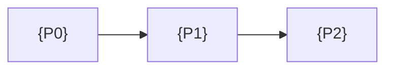

# Roadmap: {project name}

Last updated {YYYY-MM-DD}. Owner: {name}.

This file decides the order of the work. It splits the work into phases, each ending at a tagged
release, and states the checks a release must pass. Where this file and the architecture
document disagree about when something lands, this file wins. Where they disagree about what
something is, the architecture document wins.

> **Good:** every milestone has an ID that never changes, the milestones it depends on, and the
> phase that holds it. Nothing is deleted. An idea that moves gets a line in section 5 saying
> why.

## 1. How to read this file

A milestone ID names one idea. The ID never changes and the idea is never removed.

| Tier       | ID form    | What it holds                                       |
| ---------- | ---------- | --------------------------------------------------- |
| {Product}  | {P-1, P-2} | {User-facing capabilities}                          |
| {Platform} | {C-1, C-2} | {Engineering foundations: tests, releases, schemas} |
| {Scale}    | {S-1, S-2} | {Capacity, multi-site, performance}                 |

Rules:

1. **Nothing is removed.** The status list has no "cancelled" value. A milestone that no longer
   belongs in its phase is moved, and section 5 records the move and the reason.
2. **Every milestone carries its dependencies.** A milestone with none recorded has not been
   thought through yet.
3. **One open phase at a time.** Two open phases mean two release lines to maintain.

Status words: `not started`, `in progress`, `done`.

## 2. The release invariant

Every phase ends at a tagged release, and the tag is refused unless every standing gate passes.
A standing gate re-runs at every later release, not only at the one that introduced it, so an
earlier capability cannot quietly break.

| Gate         | Assertion                                                        |
| ------------ | ---------------------------------------------------------------- |
| {GATE-QS-1}  | {The quickstart runs from a clean machine in under n minutes}    |
| {GATE-TST-1} | {The full test suite passes on the supported platforms}          |
| {GATE-DOC-1} | {Links resolve and no metric marker owed at this release is TBD} |
| {GATE-REL-1} | {The changelog has a section for this tag}                       |

The gates themselves live in [gates.yaml](gates.yaml) with their falsifiers and commands. This
table is a summary of it.

## 3. Phase table

| Phase          | Tag      | Delivers                                            | Status   |
| -------------- | -------- | --------------------------------------------------- | -------- |
| {P0 Contracts} | {v0.1.0} | {Interfaces, schemas, release pipeline, no product} | {status} |
| {P1 Skeleton}  | {v0.2.0} | {Thinnest end-to-end slice, deployed}               | {status} |
| {P2 Name}      | {v0.3.0} | {capabilities}                                      | {status} |

> **Good:** the first phase fixes the decisions a later phase cannot change without breaking
> what already exists: data formats, interfaces, the release pipeline. It ships no product, and
> that is the point.

## 4. Phase detail

### {P1 Skeleton} ({v0.2.0})

- Milestones: {IDs}
- Depends on: {phases}
- Gates first in force: {gate IDs}
- Exit: {the condition that closes the phase, beyond the standing gates}

## 5. Resequencing record

Every move of a milestone between phases, with the reason.

### Change {n}: {milestone} moves from {phase} to {phase}

{Date. What moved, the dependency or evidence that forced it, and what it unblocks or delays.}

## 6. Dependency graph

## 7. How milestones become issues

{Which tool generates or tracks issues from this file, the labels used, and the rule that an
issue for a milestone is never closed as "not planned".}

## 8. Milestone index

Every milestone ID with the phase that holds it. An ID with no row here is a silent cut.

| ID    | Title   | Phase | Depends on |
| ----- | ------- | ----- | ---------- |
| {P-1} | {title} | {P1}  | {IDs}      |

## Worked example

Acme Logistics planned the TL-1 platform in four phases. P0 fixed the reading format, the
gateway-to-cloud interface, and a release pipeline that signs firmware images; it shipped no
feature. When the door-open alert (P-4) turned out to need the gateway's local rule engine (C-6),
P-4 moved from P1 to P2 and the resequencing record gained "Change 1: P-4 waits for C-6, which
lands in P2".
