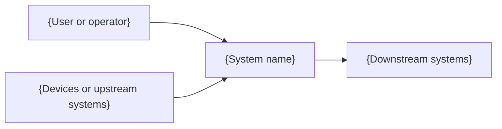
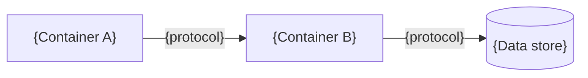

# Architecture: {system name}

Last checked against the code: {YYYY-MM-DD}, commit {short SHA}.

This page explains how {system name} fits together, for an engineer who is new to it. It covers
the parts, how data moves between them, what runs where, and how the system behaves when a part
fails. Decisions and their alternatives are in the [decision records](adr-index.md). Detailed
behavior of each subsystem is in its design specification.

> **Good:** a new engineer can read this in twenty minutes and then find the code for any part
> of the system. Every module named here exists in the tree, and every module in the tree is
> named here.

## 1. Context

{One paragraph: who uses the system, what it talks to, and which of those it does not control.}

## 2. Containers

{The deployable or physical units: services, databases, devices, gateways, queues. One diagram,
then a table.}

| Container | Runs on                    | Responsibility | Code      |
| --------- | -------------------------- | -------------- | --------- |
| {name}    | {host, device, or service} | {one sentence} | `{path/}` |

## 3. Data flow

{Follow one unit of data from where it is created to where it is used, step by step. Name the
format and the transport at each step. Note where data can be lost or duplicated and what
prevents it.}

1. {Step}

## 4. Module map

| Module          | Responsibility | Depends on |
| --------------- | -------------- | ---------- |
| `{path/module}` | {one sentence} | {modules}  |

{State the layering rule, if there is one, and what enforces it.}

## 5. Hardware

{For systems with physical parts: board or host, peripherals, connections, power, and the pins
or ports that carry each. Note any part that limits the design, such as a pin shared between two
functions. Delete this section for software-only systems.}

## 6. Connectivity and transports

| Link     | Transport  | Security                | When it is used               |
| -------- | ---------- | ----------------------- | ----------------------------- |
| {A to B} | {protocol} | {TLS, mutual TLS, none} | {always, fallback, on demand} |

## 7. Concurrency

{Threads, tasks, processes, or event loops; what each owns; how they share data; and which locks
or queues protect shared state.}

## 8. Capacity

Carry forward the ranges from the kickoff brief and the design choices each one drove.

| Quantity   | Range         | Design consequence              |
| ---------- | ------------- | ------------------------------- |
| {quantity} | {low to high} | {what was chosen because of it} |

## 9. Resilience

| Failure                                 | Detected by                       | Behavior                               |
| --------------------------------------- | --------------------------------- | -------------------------------------- |
| {Dependency down, link lost, disk full} | {timeout, health check, watchdog} | {retry, degrade, hold, restart, alert} |

{Describe any recovery ladder: the order of escalating actions, and the point at which the
system stops trying and asks for a person.}

## 10. Security

{Trust boundaries, authentication between parts, where secrets live, and a link to the
[threat model](../06-security/threat-model.md).}

## 11. Build and release

{How the code becomes an artifact, how artifacts are versioned and signed, and how they reach
the environments. Link the [release checklist](../07-release/release-checklist.md).}

## 12. Technology choices

| Area   | Choice and version | Main alternative rejected | Decision record |
| ------ | ------------------ | ------------------------- | --------------- |
| {area} | {choice}           | {alternative}             | {ADR-NNNN}      |

## 13. What this design does not claim

{The limits a reader should know: conditions it was not designed or tested for, guarantees it
does not make. Scoping the claim here stops a reader from assuming a property the system lacks.}

## Worked example

The TL-1 architecture page has four containers: the sensor, the cab gateway, the ingest service,
and the time-series store. Section 9 lists "gateway loses cellular for up to 72 hours" with the
behavior "readings buffer in flash, oldest dropped first after 72 hours, the drop is counted and
reported on reconnect". Section 13 states that the design was not tested below minus 30 C.
