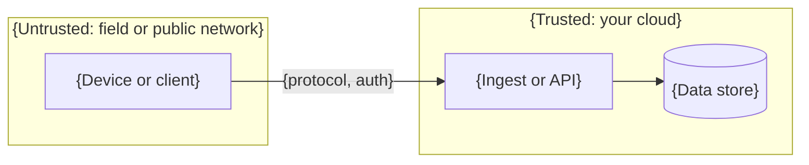

# Threat model: {system name}

Version {n}, {YYYY-MM-DD}. Reviewed against commit {short SHA}. Owner: {name}.

A STRIDE threat model, one pass per attack surface. Each item names either a control or a gap. A
control is listed only when someone read it in the code or configuration cited. A claim with
nothing behind it is a gap, and the gap says where it is tracked.

> **Good:** a reader can open the cited file and find the control. Accepted risks are written as
> decisions, with who accepted them and why. A threat model where every item is "mitigated" was
> not written by someone looking for problems.

STRIDE: **S**poofing, **T**ampering, **R**epudiation, **I**nformation disclosure, **D**enial of
service, **E**levation of privilege.

## 1. System and trust boundaries

{One paragraph on what crosses each boundary and how it is authenticated.}

## 2. Assets

| Asset                         | Why an attacker wants it | Where it lives |
| ----------------------------- | ------------------------ | -------------- |
| {credentials, data, firmware} | {reason}                 | {location}     |

## 3. Threat actors

- {Actor, what they can reach, and what they are assumed able to do}

## 4. Surfaces

### 4.1 {Surface name} (`{files or components}`)

| STRIDE | Threat                            | Control or gap                                         | Evidence or tracking      |
| ------ | --------------------------------- | ------------------------------------------------------ | ------------------------- |
| T      | {Malicious update image}          | Control: {signature checked before install}            | `{file}:{function}`       |
| S      | {Rogue server}                    | Gap: {server not authenticated on fallback path}       | {issue or hardening item} |
| E      | {Downgrade to a vulnerable build} | Accepted risk: {reason, who accepted, decision record} | {ADR-NNNN}                |

{Repeat for each surface: remote management, data upload, local network, physical access, stored
secrets, logs and debug interfaces, build and release pipeline, third-party dependencies.}

## 5. Ranked threats

| Rank | Threat (surface, STRIDE) | Likelihood | Impact  | Response                              |
| ---- | ------------------------ | ---------- | ------- | ------------------------------------- |
| 1    | {threat}                 | {H/M/L}    | {H/M/L} | {mitigation, or accepted with reason} |

## 6. Controls this model requires

{The verification controls the ranked threats make mandatory, for example by OWASP ASVS section
or your platform's security baseline. The architecture conformance table marks these as
required.}

## 7. Known gaps

The recurring themes, each tracked in the [hardening status](hardening-status.md) or the security
policy.

1. {gap}

## 8. Review

{When this model is reviewed: at each release that changes a surface, after any security
incident, and at least {interval}.}
