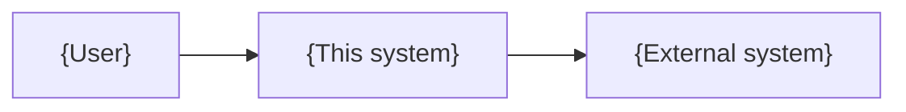

# Architecture

Last checked against the code: {YYYY-MM-DD}.

{One paragraph: what the system does, the main parts, and what it talks to. Keep this file short
and true. Every module named here exists, and every module in the tree is named here.}

## Context

## Parts

| Part   | Responsibility | Code      |
| ------ | -------------- | --------- |
| {name} | {one sentence} | `{path/}` |

## Data flow

1. {Step, naming the format and transport}

## Failure behavior

| Failure           | Behavior                       |
| ----------------- | ------------------------------ |
| {dependency down} | {retry, degrade, or fail fast} |

## Decisions

The reasons behind the main choices are in [docs/adr/](docs/adr/README.md).

## Limits

{What the design does not claim: untested conditions, unsupported platforms, known ceilings.}
